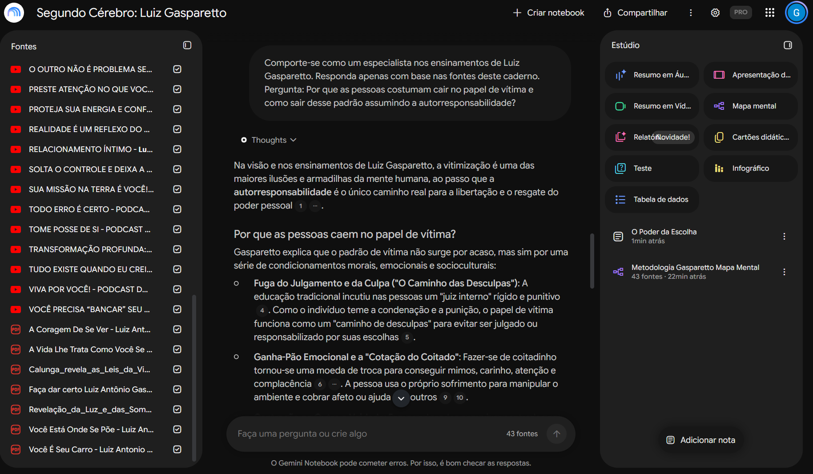
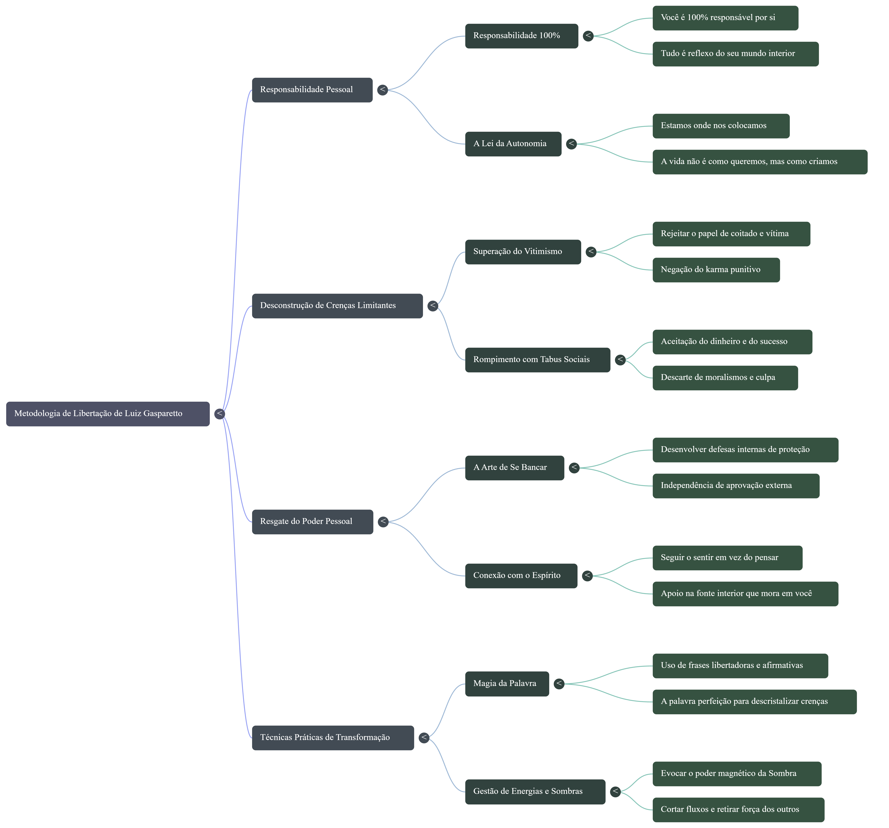

# 🧠 Segundo Cérebro: O Guia Gasparetto de Autoconhecimento

## 🎯 Tema e Objetivo
* **Tema:** Psicologia Comportamental, Inteligência Emocional e Autorresponsabilidade.
* **Objetivo:** Criar um assistente virtual especialista nos ensinamentos de Luiz Gasparetto. Este segundo cérebro funciona como uma base de consulta rápida para compreender o comportamento humano, fortalecer a autoestima, desconstruir crenças limitantes e aplicar a inteligência emocional na resolução de desafios diários.

---

## 📚 Fontes Selecionadas e Critérios de Curadoria
O caderno foi alimentado com **43 fontes verificadas**, combinando diferentes formatos (livros em PDF e palestras/podcasts em vídeo do YouTube) para garantir profundidade teórica e aplicação prática.

**Critérios para a escolha das fontes:**
* **Conteúdo Primário e Denso:** Priorizei obras completas e palestras longas do próprio autor, evitando cortes curtos ou frases soltas fora de contexto.
* **Obras em PDF incluídas:** *A Coragem de Se Ver*, *A Vida Lhe Trata Como Você Se Trata*, *Faça Dar Certo*, *Você Está Onde Se Põe*, *Você É Seu Carro*, *Calunga Revela as Leis da Vida* e *Revelação da Luz e das Sombras*.
* **Palestras e Podcasts (YouTube):** Vídeos focados em gerência interior, limites nos relacionamentos, superação do vitimismo e resgate do poder pessoal (ex.: *Tome Posse de Si*, *O Outro Não É Problema Seu*, *Todo Erro É Certo*, *Assuma Sua Força*).

---

## 🤖 Diretriz de Comportamento (Prompt)
Para garantir que o Gemini Notebook respondesse com fidelidade às fontes sem inventar informações, utilizei a seguinte diretriz:

> *"Comporte-se como um especialista nos ensinamentos de Luiz Gasparetto. Responda apenas com base nas fontes deste caderno."*

---

## 💬 Interações, Respostas e Fontes Citadas

### Pergunta Realizada:
**"Por que as pessoas costumam cair no papel de vítima e como sair desse padrão assumindo a autorresponsabilidade?"**

### Resposta do Segundo Cérebro (com base nas fontes):
Na visão e nos ensinamentos de Luiz Gasparetto, a vitimização é uma das maiores ilusões e armadilhas da mente humana, ao passo que a autorresponsabilidade é o único caminho real para a libertação e o resgate do poder pessoal *(Fontes citadas no chat: [1], [4], [5], [6], [9], [10] — incluindo obras como "Você Está Onde Se Põe", "A Coragem de Se Ver" e "Faça Dar Certo")*[cite: 3].

**Por que as pessoas caem no papel de vítima?**
* **Fuga do Julgamento e da Culpa ("O Caminho das Desculpas"):** A educação tradicional incutiu nas pessoas um "juiz interno" rígido e punitivo. Como o indivíduo teme a condenação, o papel de vítima funciona como um caminho de desculpas para evitar ser responsabilizado por suas escolhas[cite: 3].
* **Ganha-Pão Emocional e a "Cotação do Coitado":** Fazer-se de coitadinho tornou-se uma moeda de troca para conseguir atenção e complacência, usando o sofrimento para cobrar afeto ou ajuda dos outros[cite: 3].
* **Centração no Outro e Vaidade:** Viver tentando agradar e buscando aprovação externa gera frustração quando o mundo não corresponde, levando ao sentimento de "pobre de mim"[cite: 3].
* **Choque entre Fantasias e Realidade:** Alimentar expectativas irrealistas sobre como o mundo "deveria" ser gera a sensação de injustiça diante da realidade[cite: 3].
* **Imaturidade e Ilusão do Carma Punitivo:** A recusa em amadurecer e a crença de que o sofrimento é um castigo tiram da pessoa o poder de agir e transformar a própria história[cite: 3].

**Como sair desse padrão assumindo a Autorresponsabilidade?**
1. **Assumir a Lei dos 100% de Responsabilidade:** Reconhecer que cada um é 100% responsável por tudo o que acontece na sua vida, recuperando o poder de mudar a realidade[cite: 3].
2. **Extinguir a Culpa e Compreender o Erro:** Entender que o erro é apenas um estímulo funcional para o aprendizado e não um crime a ser punido[cite: 3].
3. **Recolher o Poder de Volta e Centrar-se em Si:** Aplicar o princípio de que *"a vida o trata como você se trata"*, colocando o bem-estar interior em primeiro lugar[cite: 3].
4. **Desapegar das Fantasias e Encarar o Real:** Aceitar a realidade sem dramas e desfazer expectativas sobre o comportamento alheio[cite: 3].
5. **Saber Dizer "Não":** Abandonar a necessidade de ser "salvador" para ser aceito, impondo limites saudáveis[cite: 3].

### 📸 Evidência das Citações no Chat:

---

## 🗺️ Materiais de Estudo Gerados (Estúdio)
A partir do cruzamento das 43 fontes no Estúdio do Gemini Notebook, foram gerados dois materiais práticos de estudo:

### 1. Apresentação em Slides (PDF)
Apresentação detalhada (*Mecânica da Transformação*) cobrindo os pilares da metodologia de Luiz Gasparetto[cite: 9, 24]:
* 📄 **[Clique aqui para visualizar ou baixar a Apresentação em Slides (apresentacao.pdf)](apresentacao.pdf)**

### 2. Mapa Mental (PNG)
Estrutura visual da **Metodologia de Libertação de Luiz Gasparetto** dividida em *Responsabilidade Pessoal*, *Desconstrução de Crenças Limitantes*, *Resgate do Poder Pessoal* e *Técnicas Práticas de Transformação*[cite: 4]:

---

## 🔗 Link do Notebook Compartilhado
Acesse o caderno interativo diretamente no Gemini Notebook através do link abaixo:
👉 **[Acessar Segundo Cérebro: Luiz Gasparetto](https://notebook.google.com/notebook/9c156717-8cff-48f9-a273-9c7f1d067503)**
